# active-directory-lab
Built a two VM Active Directory environment from scratch in VirtualBox: a Windows Server 2016 domain controller running AD DS and DNS for a new forest ('epf.com'), and a Windows 10 Pro workstation joined to that domain. Configured the private network and static addressing, verified connectivity in both directions, created and tested a domain user, and automated security group creation with Powershell.

**Skills demonstrated:** VirtualBox networking · static IPv4/DNS configuration · network troubleshooting (ipconfig,ping) · AD DS/DNS role installation · domain join · Active Directory Users and Computers (ADUC) · user and security group administratrion ·Powershell ActiveDirectory module · rerunnable scripting
### Environment
| Role | OS | vCPU | RAM | IP | Notes |
| :-| :-| :-| :-| :-| :-|
| Domain controller ('epf.com') | Windows Server 2016 | 4 | 8 GB | '10.1.1.10/24' | AD DS + DNS roles; DNS points to itself |
| Client workstation ('DESKTOP-PGPFE3E') | Windows 10 Pro | 2 | 2 GB | '10.1.1.20/24' | Joined to 'epf.com' |
| Host | Windows 11 | - | 16 GB | - | VirtualBox; both VMs run concurrently |

Hypervisor: Oracle VirtualBox. Both VMs sit on a VirtualBox internal/private network so they can talk to each other without touching the host LAN.
<details>
<summary>VMs and host resource screenshots</summary>
Windows 10 client (2 GB) · Windows Server 2016 (8 GB) · Host with both VMs running
  
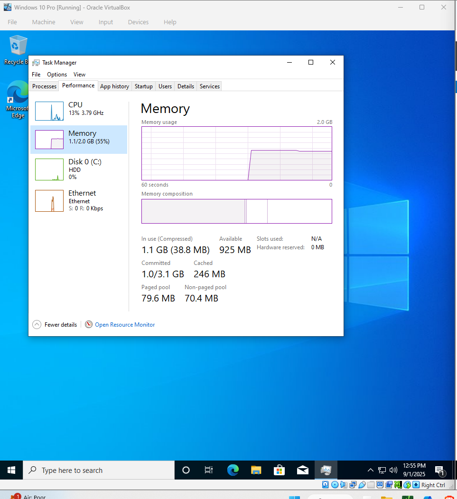
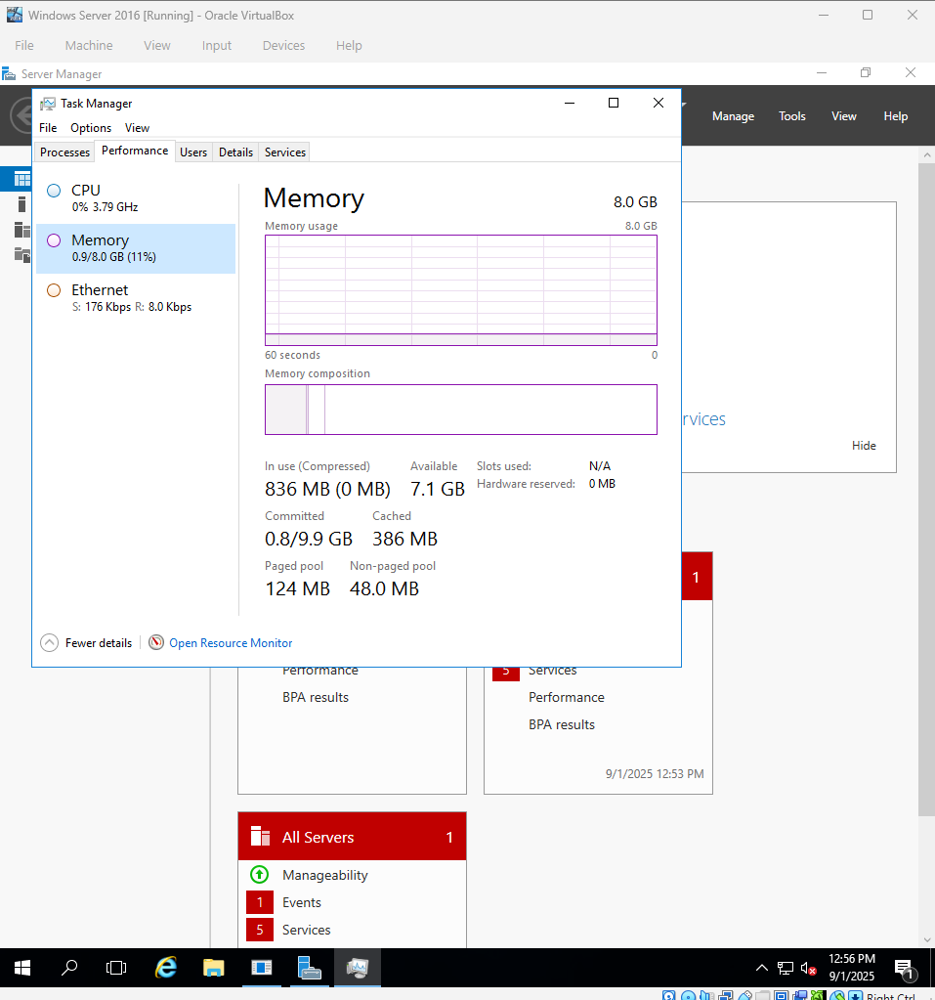
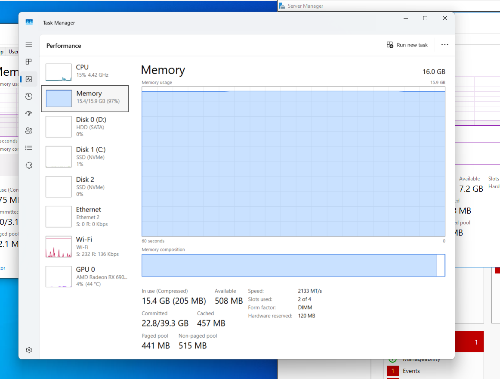
</details>
---

### What I did 
### 1. Put both VMs on the same private network with static addresing
Assigned the server static address of `10.1.1.10/24` and pointed its preferred DNS at itself (`10.1.1.10`), since it would become the DNS server for the domain. Gave the client `10.1.1.20/24`.
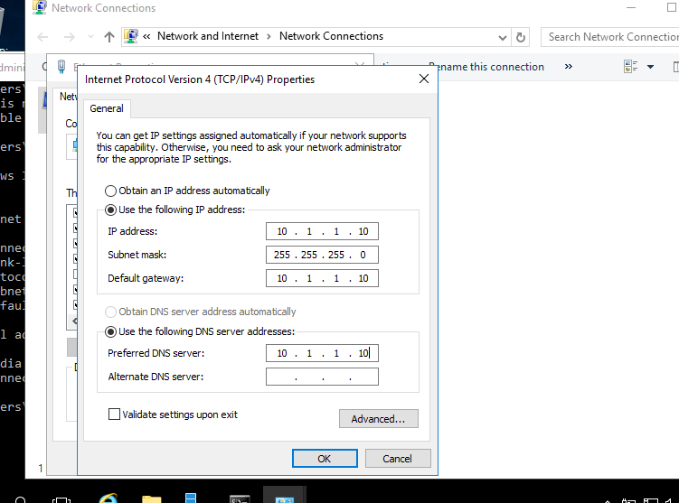
| Domain controller | Client |
| - | - |
| 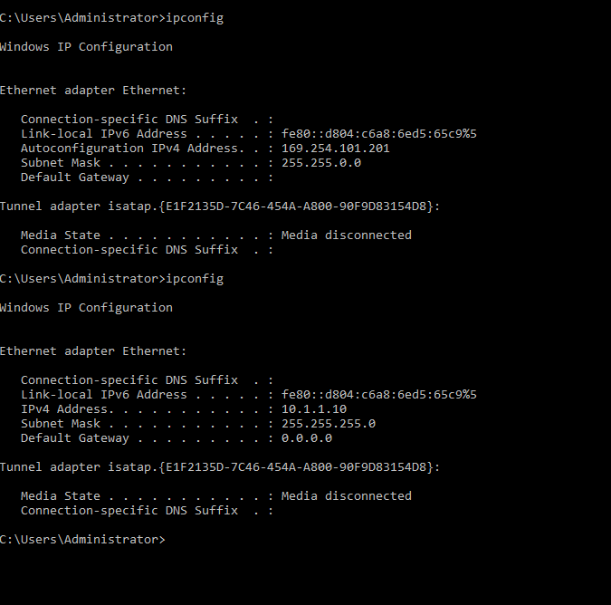 | 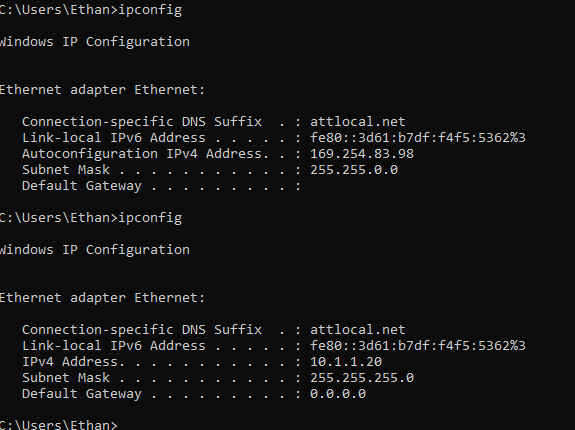 |

### 2. Verify connectivity in both directions
The first ping from the client to `10.1.1.10` timed out (100% loss) becasue the client was still on its APIPA address at that point and wasn't on the same subnet. After applying the static `10.1.1.20` address the same ping succeeded with 0% loss and 1 ms RTT.\
Confirmed the reverse path from the DC to the client as well:

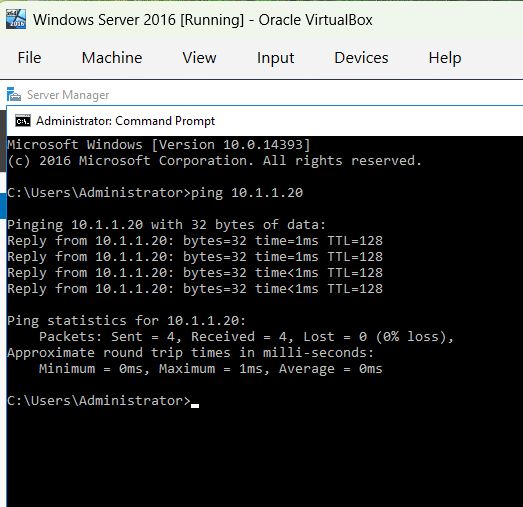

### 3. Install AD DS + DNS and promote the server to a domain controller
Installed the Acticve Directory Domain Services and the DNS Server roles through Server Manager, then promoted the server to a domain controller for a new forest named `epf.com`. After the reboot, ADUC shows the new domain with its default containers.

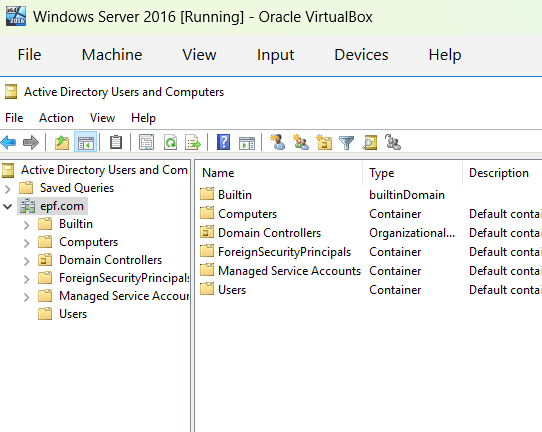

### 4. Join the Windows 10 client to the domain
From System Properties on the client, changed membership from `WORKGROUP` to the `epf.com` domain and authenticated with domain admins credentials. The "Welcome to the epf.com domain" prompt confirms the join, this works becasue the client's DNS already resolves `epf.com` through the DC.

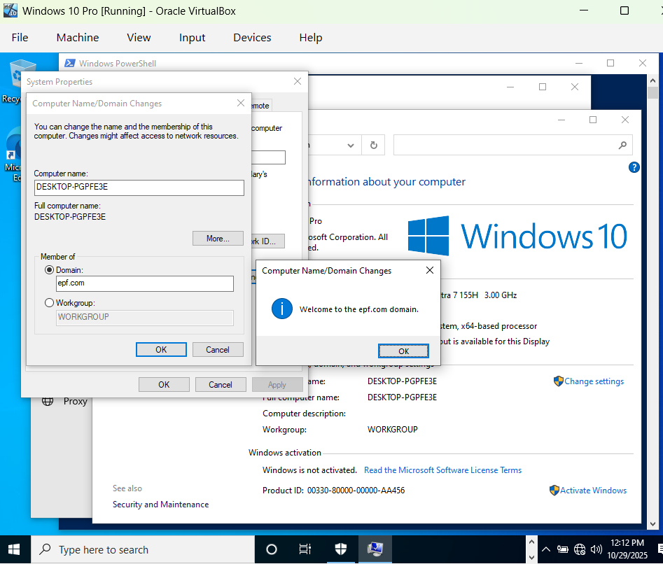

Back on the DC, the workstation's computer object now appears in the **Computers** container with the DNS name `DESKTOP-PGPFE3E.epf.com`:

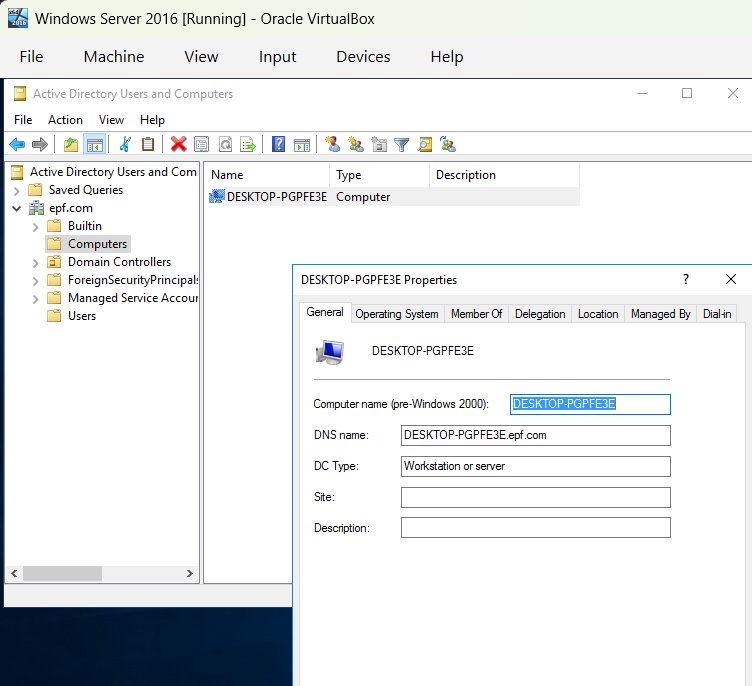

### 5. Create a domain user and log in with it
Created a user `Test Account` (logon `test@epf.com`) in ADUC, then signed in to the Windows 10 client with that domain account. The Accounts page in Settings shows the session running as `EPF\Test`, and the network flyout shows the machine on the `epf.com` network.
| New user in ADCU | Logged in on the client |
| - | - |
| 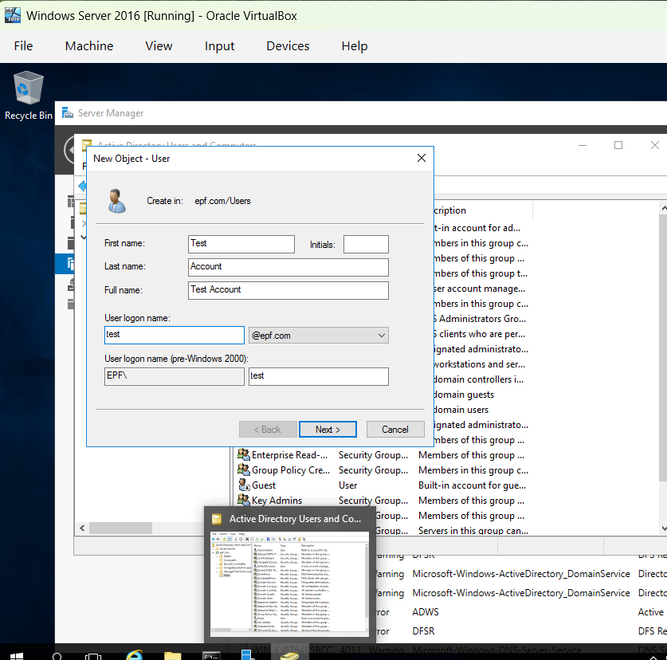 | 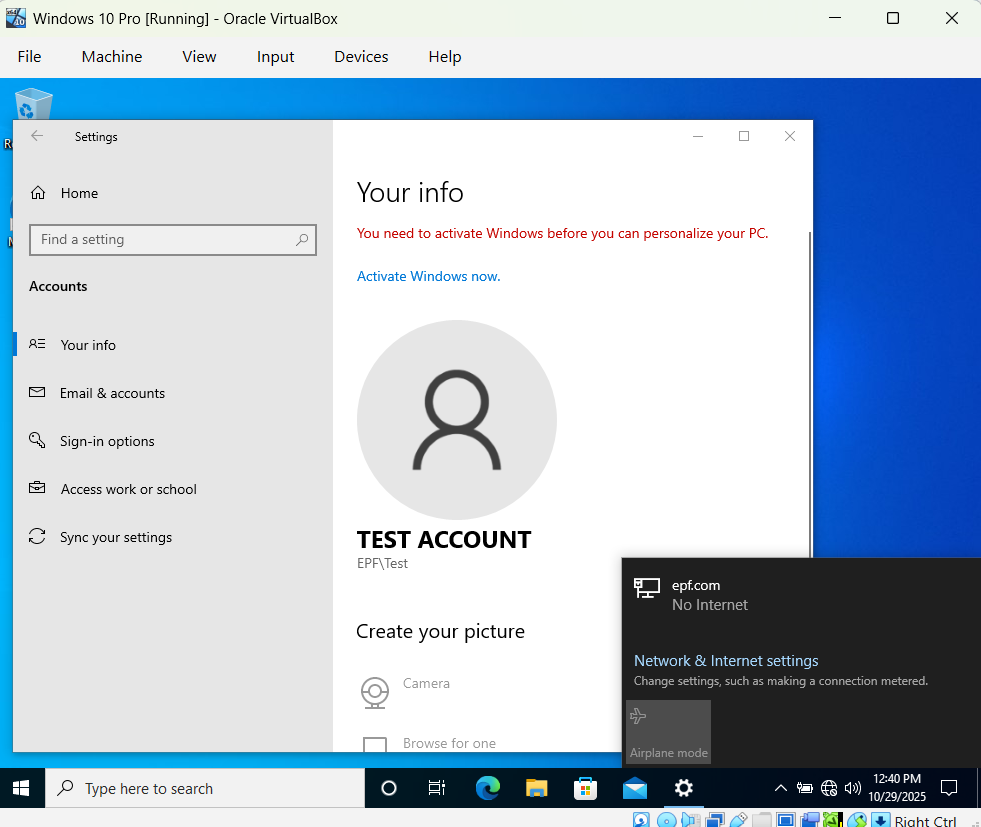 |

### 6. Automate security group creation with powershell
Wrote `scripts/New-ADGroups.ps1` to create five global security groups (`IT`, `HR`, `Executive`, `OPS`, `Billing`) in the domain's Users container and then list them for verification. The script doesn't use a hardcoded domain, it resolves the domain DN with `(Get-ADDomain).DistinguishedName` so it works unchanged in any domain. In the script each group is created only if `Get-ADGroup-LDAPFilter "(name=$g)"` finds nothing in the target container, so rerunning the script is safe and doesn't error out on duplicates.

```powershell
foreach ($g in $groups) {
    if (-not (Get-ADGroup -LDAPFilter "(name=$g)" -SearchBase $groupPath -ErrorAction SilentlyContinue)) {
        New-ADGroup -Name $g -SamAccountName $g -GroupScope Global -GroupCategory Security -Path $groupPath
    }
}
```
---
### Contraints and notes
- Host RAM is 16 GB; with both VMs allocated (8 GB + 2 GB) the host sat at 97% memory utilization. Both VMs ran concurrently without major insatiability, but there was no room for a third VM without reducing the DC's allocation.
- All addresses in the screenshots are private lab addresses on an isolated VirtualBox netork
- Built as part of coursework at UTSA (BS Computer Science); the environment, configuration, and script are my own work.


